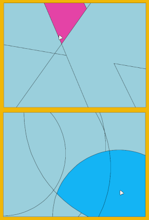

# ShapeMaker
processing tool to create random polygons

## Installation

You need to install Geometry Suite for Processing version 2.2 with Contribution Manager 

## Ussage

Click to merge 2 polygons together

Press 'd' to delete polygon

Press 's' to save as .svg

Press 'tab' to toggle between sharp or rounded shapes

Press 'a' or 'z' to add less or more lines

Press 'e' or 'r' to switch random seed
